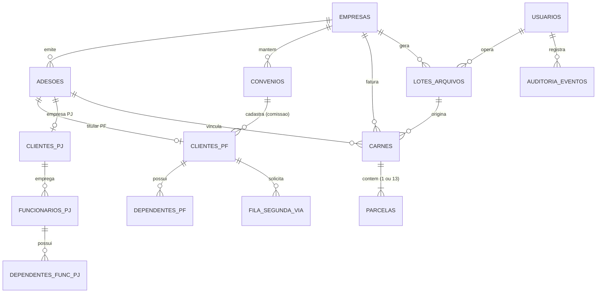
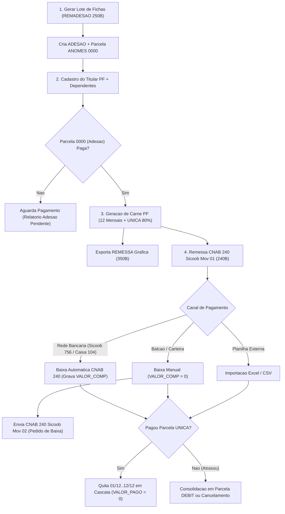

# Documento Mestre de Engenharia Reversa, Requisitos e Especificação Técnica — Sistema SGC (`SGCeFeGe`)

> **Versão da Especificação:** `1.0.0` (Pacote Completo para Reconstrução Web por IA Agêntica)  
> **Sistema Legado Analisado:** `SGCeFeGe.exe` (*Gestão de Carnês* — Delphi 7, `v1.0` / `v1.1.14`, FGDigital LTDA)  
> **Banco de Dados Analisado:** `ABAC.FDB` (Firebird `2.5` `ODS 11.2`, SQL Dialect 3, `Windows-1252`)  
> **Motor de Relatórios Analisado:** `Relatorios.rav` (Nevrona Rave Reports `5.0`, binário `RAV v156` comprimido em LZW)  
> **Arquitetura Alvo:** Aplicação Web Moderna (**Python / FastAPI** ou **Java 21 / Spring Boot**) + **React / Next.js** + **PostgreSQL 16+ Online**

---

## 1. Sumário Executivo e Visão do Produto

O **SGC (`SGCeFeGe.exe`)** é um sistema de gestão cadastral, comercial e financeira voltado à administração de **planos assistenciais / funerários / convênios de benefícios recorrentes** para **Pessoas Físicas (Titulares e Dependentes)** e **Pessoas Jurídicas (Empresas Clientes, seus Funcionários Titulares e respectivos Dependentes)**.

O núcleo operacional do sistema controla todo o ciclo de receita recorrente:
1. **Emissão prévia de fichas numeradas de adesão** para equipes comerciais externas (*Cadastrantes / Comissionados*) via arquivos posicionais para gráfica (`REMADESAO`, 250 colunas);
2. **Cadastro de titulares e dependentes** vinculado ao pagamento da taxa de adesão (`ANOMES = '0000'`);
3. **Geração periódica quinzenal de carnês anuais PF** contendo **12 parcelas mensais + 1 parcela de cota anual antecipada (`ÚNICA`) com 20% de desconto**, além de **faturamento mensal corporativo PJ** e **fila de 2ª via de carnês e carteirinhas plásticas**, exportados em layout posicional de 350 colunas (`REMESSA`, `SEG_VIA_CARNE`, `SEG_VIA_CARTÃO`);
4. **Cobrança bancária registrada FEBRABAN CNAB 240** junto ao **Sicoob (`756`)** (remessa de registro de títulos, pedido de baixa de títulos recebidos no balcão e renegociação/consolidação de atrasados em parcela `'DEBIT'`);
5. **Conciliação financeira multicanal** (baixa manual no caixa, retorno CNAB 240 **Sicoob `756`** e **Caixa Econômica Federal `104`**, e importação em lote via planilhas Excel) com apuração de tarifas bancárias de compensação, receita líquida e **comissões de cadastrantes**.

---

## 2. Metodologia de Engenharia Reversa Executada

Para garantir **100% de cobertura funcional sem suposições**, foram combinadas quatro frentes de análise estática e estrutural:

| Artefato Original | Ferramental Aplicado | Resultado Obtido |
|---|---|---|
| `SGCeFeGe.exe` (`32-bit PE`, Borland Delphi 7) | `morluto/rea` (`rea-agents@6.8.0`) + descompilador `kuna v1.986` (`--jobs 1`) + extrator de RTTI/DFM | **3.966 de 3.966 funções descompiladas (`0` falhas)** em C/ASM, **36 units da aplicação** mapeadas e **43 recursos `.dfm`** integralmente extraídos |
| `ABAC.FDB` (`32,1 MB`, Firebird 2.5) | Inspeção read-only via `firebird-driver` / metadados `RDB$*` | **12 tabelas**, **9 generators**, **8 índices**, **11 chaves estrangeiras** e volumetria real agregada (zero exposição de dados pessoais/PII) |
| `Relatorios.rav` (`17.074` bytes) | Descompressor customizado **LZW 8-a-13 bits MSB-first** em 2 níveis | **68.968 bytes descomprimidos**, revelando todos os **6 `TRaveDataView`** e o layout completo dos **6 `TRaveReport`** |
| `*.bmp` (`7` arquivos de imagem) | Inventário de recursos visuais | Identificados como ícones legados de botões VCL (`atualizar`, `Cancelar`, `Consultar`, `Excluir`, `Fechar`, `fg`, `novo`) — **descartados na versão web** conforme diretriz |

### Volumetria Agregada do Banco de Produção (`ABAC.FDB`)
*(Apenas contagens estatísticas anônimas para dimensionamento do banco online PostgreSQL)*:
- **`ADESAO`:** ~`19.300+` números de adesão gerados (`GEN_NUMERO_ID` na faixa de `19.400+`).
- **`CLIENTES` (PF) + `DEPENDENTES`:** milhares de titulares PF e dependentes históricos (ativos, inativos e cancelados).
- **`PESSOAJURIDICA` + `FUNCIONARIOSPESSOAJURIDICA` + `DEPFUNCPESSOAJURIDICA`:** carteira empresarial ativa em operação.
- **`CONVENIOS` (Cadastrantes):** dezenas de vendedores/representantes comissionados.
- **`CARNE` + `PARCELAS`:** centenas de milhares de parcelas históricas (`GEN_NOSSONUMERO_ID` ativo), exigindo índices compostos otimizados no PostgreSQL para consultas instantâneas de inadimplência e relatórios.
- **`ENDERECOS`:** **`0` registros** (tabela órfã legada, sem tela vinculada — descartada na nova arquitetura).

---

## 3. Explicação dos Arquivos Especiais do Legado

### 3.1 O que é `Relatorios.rav`?
É o arquivo binário compilado de relatórios do **Nevrona Rave Reports 5.0** utilizado pelo Delphi 7. Ao contrário de relatórios codificados diretamente no `.exe`, o `SGCeFeGe.exe` abre `Relatorios.rav` em tempo de execução por meio do componente `DM.RvProject` e injeta os dados das queries Firebird através de conexões `TRvDataSetConnection`. Descomprimimos integralmente o arquivo e documentamos todos os seus **6 relatórios oficiais** (além do **7º relatório de Pessoa Jurídica** que estava inacabado no menu oculto `Relatorio1`) em [05_especificacao_relatorios_rave.md](especificacao_tecnica/05_especificacao_relatorios_rave.md).

### 3.2 O que são os arquivos `.bmp` na raiz?
São ícones bitmap 16x16/24x24 da biblioteca visual VCL do Windows XP/Delphi 7 (`atualizar.bmp`, `Cancelar.bmp`, `Consultar.bmp`, `Excluir.bmp`, `Fechar.bmp`, `novo.bmp`) e a marca da software house original (`fg.bmp`). Na aplicação web moderna, **não devem ser copiados nem utilizados**, sendo substituídos por ícones SVG modernos (`Lucide Icons`). A logomarca institucional do cliente final usada no cabeçalho dos relatórios fica gravada no banco de dados (`EMPRESAS.LOGOMARCA`) e será migrada para PNG/WebP.

---

## 4. Glossário do Domínio de Negócio

| Termo no Sistema | Significado Exato no Domínio |
|---|---|
| **Ficha de Adesão (`ADESAO` / `ANOMES = '0000'`)** | Número sequencial único pré-gerado para formulários físicos de venda externa. Ao criar o lote, nasce uma parcela `ANOMES = '0000'` (`ID_PARC = 'ADESÃO'`). O 1º carnê do cliente PF só é gerado após a baixa dessa parcela `'0000'`. |
| **Cadastrante / Comissionado (`CONVENIOS`)** | Vendedor, representante ou parceiro comercial vinculado ao cliente PF (`COD_CONVENIO`), remunerado por um percentual (`PERC_COM`) sobre cada parcela efetivamente paga pelo cliente. |
| **Carnê PF (`12 + UNICA`)** | Conjunto de **13 lâminas** gerado para o cliente PF ativo: 12 parcelas mensais (`'01/12'` a `'12/12'`) + 1 lâmina opcional `'UNICA'` (`ANOMES = AA + '99'`) com vencimento igual à `'01/12'` e **20% de desconto exclusivamente sobre as 12 mensalidades base** (`UNICA = (mensalidade * 12 * 0,80) + Taxa de Manutenção Anual`, sem desconto na taxa). |
| **Taxa de Manutenção Anual** *(antigo "Acréscimo de Renovação")* | Taxa anual (default R\$ 12,00, configurada no plano) cobrada **a partir do 2º carnê PF**, somada à parcela `'01/12'` e **sem desconto** à parcela `'UNICA'` (registrada em `valor_taxa_manutencao_embutida`). Distingue-se da **Taxa de Adesão** (cobrada na matrícula inicial) e da **Taxa de Reativação** (cobrada no retorno de ex-cliente, que isenta o 1º carnê pós-reativação da Taxa de Manutenção). |
| **Parcela `'DEBIT'` (`ANOMES = AA + '00'`)** | Boleto único de renegociação gerado na aba *Clientes Inadimplentes* de *Gerar Remessa*, somando até $N$ parcelas atrasadas e baixando contabilmente as originais com `VALOR_PAGO = 0,00`. |
| **Valor de Compensação (`VALOR_COMP`)** | Tarifa bancária cobrada pelo banco (Caixa/Sicoob) na liquidação do boleto via CNAB 240. `Valor Líquido = Valor Pago - Valor de Compensação`. Em pagamentos no balcão (baixa manual), `VALOR_COMP = 0,00`. |
| **Remessa Gráfica (`350` colunas)** | Arquivo texto posicional (`REMESSA*.TXT`, `SEG_VIA_*.TXT`) enviado à gráfica terceirizada para impressão física de carnês e cartões plásticos de associado/dependentes. |
| **Data de Arquivo (`DATA_ARQ`)** | Data agendada na tabela `EMPRESAS` (ciclos nos dias `10` e `25` de cada mês) que alerta o operador na abertura do sistema sobre o momento de rodar um novo lote de carnês. |

---

## 5. Diagramas de Arquitetura de Dados e Fluxo Operacional

### 5.1 Diagrama Entidade-Relacionamento do Novo Modelo Online (PostgreSQL)

### 5.2 Fluxo Ponta a Ponta do Ciclo Financeiro e Cobrança

---

## 6. Catálogo Completo de Requisitos Funcionais (`RF-001` a `RF-032`)

| ID | Módulo | Requisito Funcional | Rastreabilidade Legada |
|---|---|---|---|
| **RF-001** | Segurança | Autenticação web por `apelido` e `senha` com hash Argon2id, tokens JWT (`Access` + `Refresh HttpOnly`) e bloqueio contra força bruta. | `TFrmLogin` / `ULib` |
| **RF-002** | Segurança | Troca da própria senha pelo operador autenticado e fluxo de redefinição/troca forçada no primeiro acesso pós-migração. | `TFrmAlterarSenha` |
| **RF-003** | Segurança | Controle de acesso baseado em 18 permissões granulares (RBAC) validado obrigatoriamente no backend e refletido nos menus da UI. | `TFrmUsuarios` / `Uprincipal` |
| **RF-004** | Empresas | Gestão multiempresa com razão social, CNPJ, endereço, upload de logomarca institucional (para PDFs), parâmetros bancários Sicoob e agendamento `DATA_ARQ`. | `TFrmEmpresas` |
| **RF-005** | Dashboard | Painel inicial com seleção de empresa ativa, alerta de vencimento do ciclo quinzenal `DATA_ARQ` (dias `10` e `25`) e indicadores financeiros em tempo real. | `TFrmPrincipal` |
| **RF-006** | Cadastros | CRUD de Cadastrantes/Comissionados (`convenios`) suportando tanto CPF quanto CNPJ validados e percentual de comissão (`perc_comissao`). | `TFrmConvenios` |
| **RF-007** | Clientes PF | Cadastro de Titular PF exigindo número de adesão válido e livre em `adesoes` (com opção de reserva automática online), validação estrita de CPF, dia de vencimento `1..28`, cadastrante e banco de cobrança (`1-Caixa` / `2-Sicoob`). | `TFrmClientes` |
| **RF-008** | Clientes PF | Gestão ilimitada de Dependentes PF vinculados ao titular (nome, CPF opcional validado, data de nascimento e grau de parentesco). | `TFrmClientes (TabSheet1)` |
| **RF-009** | Clientes PJ | Cadastro de Empresas Clientes PJ com alocação automática de número em `adesoes`, CNPJ validado, IE/IM, contato, dia de vencimento `1..28` e observações. | `TFrmCadastroPessoaJuridica` |
| **RF-010** | Clientes PJ | Cadastro de Funcionários Titulares vinculados à Empresa PJ com dados pessoais completos, `valor_plano` individual e situação (`Ativo`/`Inativo`). | `TFrmCadastroFuncPessoaJuridica` |
| **RF-011** | Clientes PJ | Cadastro de Dependentes vinculados a cada Funcionário Titular de Empresa PJ. | `TFrmCadastroPessoaJuridica` |
| **RF-012** | Adesões | Geração em lote de $N$ fichas de adesão pré-numeradas, criando carnê `NUM_PARC = 1`, parcela `ANOMES = '0000'` (`ADESÃO`) e arquivo `REMADESAO{rem:05d}.TXT` (250 colunas). | `TFrmAdesao` |
| **RF-013** | Adesões | Consulta de estoque e exportação de números de adesão pré-gerados e ainda não vinculados a nenhum cliente PF ou PJ. | `TFrmRecuperarArquivo` |
| **RF-014** | Carnês PF | Simulação e geração em lote de carnês anuais PF para clientes ativos com adesão `'0000'` paga e até $K$ parcelas vencidas em aberto, permitindo reconciliar divergências entre `valor_plano` e `ValorTitular + N_Dep * ValorDep`. | `TFrmCarne` |
| **RF-015** | Carnês PF | Cálculo exato das 13 lâminas por carnê PF: `'01/12'` ($M+A$), `'02/12'..'12/12'` ($M$) e `'ÚNICA'` (`AA99`, mesmo vencimento de `'01/12'`, valor $(12 \times M \times 0,80) + A$), exportando `REMESSA{rem:07d}_{banco}.TXT` (350 colunas). | `TFrmCarne` |
| **RF-016** | Fatura PJ | Simulação e faturamento mensal PJ por competência `MM/AAAA`, somando **exclusivamente funcionários com `SITUACAO = 'A'`**, bloqueando duplicidade na competência e gerando `REMESSA{rem:07d}.TXT` (350 colunas). | `TFrmBoletoBancario` |
| **RF-017** | Cobrança | Filtro de clientes inadimplentes com até $K$ parcelas em atraso e consolidação opcional dos débitos em uma única parcela `'DEBIT'` (`ANOMES = AA+'00'`), baixando as parcelas originais como `CONSOLIDADA` (`valor_pago = 0,00`). | `TfrmGerarRemessa (ts1)` |
| **RF-018** | CNAB 240 | Seleção de parcelas elegíveis (com filtro de adimplência prévia e filtro automático de CPFs válidos) e geração de arquivo **CNAB 240 Sicoob (`756`) Movimento `'01'`** (Segmentos `P`, `Q`, `R`, DV Módulo 11 `3197`), marcando `registrado = true`. | `TfrmGerarRemessa (ts2)` |
| **RF-019** | Cobrança | Geração de arquivo posicional gráfico avulso (350 colunas) para um subconjunto selecionado de parcelas em aberto. | `TfrmGerarRemessa.BitBtn1` |
| **RF-020** | CNAB 240 | Seleção de títulos registrados já recebidos em carteira (`valor_compensacao = 0` e pagos) ou por remessa e geração de **CNAB 240 Sicoob (`756`) Movimento `'02'`** (Solicitação de Baixa — Segmentos `P` e `Q` ambos com código `'02'`, sem `R`, protesto `'300'` e `NSA` sequencial). | `TfrmGerarRemessa (ts3)` |
| **RF-021** | Arquivos | Histórico completo de lotes gerados (`lotes_arquivos`) com download imediato e função de regeneração fiel de remessas de carnê e adesão por número. | `TFrmRecuperarArquivo` |
| **RF-022** | Baixas | Baixa manual de parcelas localizadas por `NUM_ADESAO + ANOMES` ou por `NOSSONUMERO`, gravando `valor_compensacao = 0,00`, aplicando cascata automática se `'ÚNICA'` e permitindo estorno auditado. | `TFrmBaixaManual` |
| **RF-023** | Baixas | Processamento automático e idempotente de múltiplos arquivos de retorno **CNAB 240 Sicoob (`756`)** (`T/U` ocorrências `'02'`, `'03'`, `'09'`, `'06'`) e **Caixa (`104`)** (`T/U` sem truncamento de adesão e `G` arrecadação), registrando tarifas em `valor_compensacao` e aplicando cascata `'ÚNICA'`. | `TFrmBaixaAutomatica (ts1)` |
| **RF-024** | Baixas | Importação em lote de baixas via planilhas `.xls`, `.xlsx` e `.csv` (Data, Identificador `NUM_ADESAO + ANOMES`, Valor Pago) com prévia de conciliação. | `TFrmBaixaAutomatica (ts2)` |
| **RF-025** | Contratos | Consulta de situação de débitos e cancelamento formal de plano (`situacao = 'C'`) protegido pela permissão `perm_cancelar_plano`, preservando histórico financeiro. | `TFrmCancelamento` |
| **RF-026** | 2ª Via | Fila multiusuário persistente para emissão de arquivos gráficos `SEG_VIA_CARNE.TXT` e `SEG_VIA_CARTÃO.TXT` (titular, dependente individual ou todos os dependentes, 350 colunas) + geração instantânea de PDF em tela. | `TFrmSegundaVia` |
| **RF-027** | Atendimento | Diagnóstico instantâneo por número de adesão ou cliente informando existência da ficha, vínculo cadastral, status de cancelamento, quitação da adesão `'0000'` e dados do último carnê/remessa. | `TFrmDiagnostico` |
| **RF-028** | Relatórios | Emissão interativa (tela) e exportação (`PDF A4`, `XLSX`, `CSV`) dos relatórios financeiros **Contas Recebidas** (Bruto, Compensação e Líquido) e **Contas a Receber** (excluindo `'ÚNICA'`). | `RelContasRecebidas` / `RelContasAReceber` |
| **RF-029** | Relatórios | Consulta drill-down (Titular, Dependentes e Parcelas) e emissão dos relatórios agrupados de **Clientes Inadimplentes** e **Clientes Adimplentes** (incluindo filtro de carnê 12/12 quitado). | `RelClientesInadimplentes` / `RelClientesAdimplentes` |
| **RF-030** | Relatórios | Emissão do **Relatório Geral de Clientes** nas 3 modalidades: Geral (Ativos/Inativos), Aniversariantes do Mês e Clientes com Adesão `'0000'` Pendente. | `RelClientesGeral` |
| **RF-031** | Relatórios | Apuração e emissão do **Relatório de Comissões de Cadastrantes** sobre parcelas pagas no período (`valor_pago * perc_comissao / 100`). | `RelConvenios` |
| **RF-032** | Relatórios | Emissão do **Relatório Financeiro de Clientes Pessoa Jurídica** (concluindo o relatório corporativo deixado oculto/inacabado no sistema legado). | `IBQryRelPessoaJuridica` / `Relatorio1` |

---

## 7. Requisitos Não Funcionais (`RNF-001` a `RNF-015`)

- **RNF-001 (Arquitetura Web Cloud-Native):** Aplicação 100% acessível via navegadores modernos (Chrome, Edge, Firefox, Safari) em desktop e tablets, sem instalação local nem dependência de rede Windows/SMB ou registro `HKCU`.
- **RNF-002 (Banco de Dados Relacional Online):** PostgreSQL `16+` gerenciado em nuvem com conexões TLS (`sslmode=require`), encoding `UTF-8`, constraints referenciais estritas e backups automatizados com Point-in-Time Recovery (PITR).
- **RNF-003 (Segurança de Credenciais e LGPD):** Senhas armazenadas exclusivamente com **Argon2id** (ou BCrypt `cost >= 12`), tráfego HTTPS TLS 1.3, mascaramento de CPF em logs e trilha imutável de auditoria (`auditoria_eventos`) para operações sensíveis.
- **RNF-004 (Exatidão Financeira):** Toda manipulação monetária deve usar ponto fixo decimal (`NUMERIC(12,2)` / `Decimal` / `BigDecimal`), proibindo ponto flutuante binário.
- **RNF-005 (Compatibilidade Binária com Gráfica e Bancos):** Os arquivos `REMADESAO` (250B), `REMESSA`/`SEG_VIA` (350B) e `CNAB 240` (240B) devem ser gerados opcionalmente em `Windows-1252` com `CRLF` para 100% de compatibilidade drop-in com os sistemas legados da gráfica e validadores Sicoob/Caixa.
- **RNF-006 (Transacionalidade e Atomicidade):** Operações em lote (geração de carnês, consolidação `'DEBIT'`, cascata `'ÚNICA'`, importação de retorno) devem ser atômicas por lote/título, sem deixar registros órfãos em caso de falha parcial.
- **RNF-007 (Idempotência):** Reprocessar acidentalmente um arquivo `.ret` CNAB 240 já importado deve ser detectado via hash SHA-256 e estado da parcela, evitando baixas duplicadas.
- **RNF-008 (Desempenho):** Consultas paginadas de clientes e parcelas devem responder em `< 300 ms` (p95) para bases de até `1.000.000` de parcelas; geração de lotes de `1.000` carnês (`13.000` parcelas) em `< 10 s` (ou via job assíncrono com barra de progresso em tempo real).
- **RNF-009 (Prevenção de SQL Injection):** 100% das consultas ao banco devem utilizar parâmetros tipados (`Prepared Statements`), eliminando toda interpolação textual de datas/strings existente no legado.
- **RNF-010 (Migração Integral Sem Perda):** O ETL inicial a partir do `ABAC.FDB` deve preservar 100% dos números de adesão, carnês, nossos números e centavos históricos de valores nominais, pagos e compensados.
- **RNF-011 (Observabilidade):** Logs estruturados em JSON com `request_id`, `usuario_id` e tempo de execução, além de endpoint `/api/v1/health`.
- **RNF-012 (Design System e Acessibilidade):** Interface limpa baseada em componentes acessíveis (`WCAG 2.1 AA`), navegação completa por teclado, feedback claro de campos obrigatórios e ícones vetoriais SVG (sem uso dos `.bmp` legados).
- **RNF-013 ( Internacionalização / Localização BR):** Formatação nativa `pt-BR` para moeda (`R\$ 1.234,56`), datas (`DD/MM/AAAA`), documentos (`CPF`, `CNPJ`, `CEP`) e fuso horário `America/Sao_Paulo`.
- **RNF-014 (Testabilidade Automatizada):** Cobertura mínima de `90%` nas regras de domínio financeiro, geradores CNAB/gráfica e parsers de retorno bancário.
- **RNF-015 (Containerização):** Entregável empacotado com `Dockerfile` multi-stage e `docker-compose.yml` reproduzível em qualquer provedor cloud.

---

## 8. Índice do Pacote de Especificação Técnica (`especificacao_tecnica/`)

Toda a profundidade de implementação para a IA agêntica está organizada nos **6 volumes técnicos complementares** dentro da pasta `especificacao_tecnica/`:

1. **[01_schema_firebird_legado.sql](especificacao_tecnica/01_schema_firebird_legado.sql)**  
   *DDL integral extraído do `ABAC.FDB` (9 generators, 12 tabelas, chaves primárias, chaves estrangeiras, índices e notas de tipos/charset do Firebird 2.5).*
2. **[02_schema_postgresql_moderno.sql](especificacao_tecnica/02_schema_postgresql_moderno.sql)**  
   *Schema PostgreSQL 16+ pronto para produção online, com enums de domínio, sequences sincronizáveis, coluna gerada `valor_liquido`, índices parciais de inadimplência, `lotes_arquivos`, `fila_segunda_via` e `auditoria_eventos`.*
3. **[03_catalogo_telas_e_fluxos_ui.md](especificacao_tecnica/03_catalogo_telas_e_fluxos_ui.md)**  
   *Mapeamento completo dos 43 recursos `.dfm` (2 DataModules, 33 telas customizadas e 8 diálogos), máscaras, validações `Tag=1`, colisões de atalhos, matriz RBAC de 18 permissões e mapa de rotas da nova SPA Web.*
4. **[04_regras_negocio_financeiro_cnab_arquivos.md](especificacao_tecnica/04_regras_negocio_financeiro_cnab_arquivos.md)**  
   *Fórmulas matemáticas exatas (`SicoobNossoNumeroDV` Módulo 11 `3197`, cota `'ÚNICA'` 80%, cascata de quitação, consolidação `'DEBIT'`, faturamento PJ), catálogo dos 10 bugs legados corrigidos e tabelas byte a byte (base 1) dos layouts de `250`, `350` e `240` colunas.*
5. **[05_especificacao_relatorios_rave.md](especificacao_tecnica/05_especificacao_relatorios_rave.md)**  
   *Descompressão LZW e especificação completa do `Relatorios.rav`: cabeçalho institucional, queries SQL parametrizadas, agrupamentos, fórmulas e totais dos 6 relatórios existentes + especificação do 7º relatório PJ.*
6. **[06_guia_execucao_ia_agentica.md](especificacao_tecnica/06_guia_execucao_ia_agentica.md)**  
   *Playbook de construção passo a passo para IA agêntica (opções **Python/FastAPI** ou **Java 21/Spring Boot** + **React/Next.js** + **PostgreSQL**), estrutura de monorepo, contrato completo de ~45 endpoints REST, roteiro ETL `Firebird -> PostgreSQL`, 8 marcos de implementação e suíte obrigatória de testes automatizados.*
